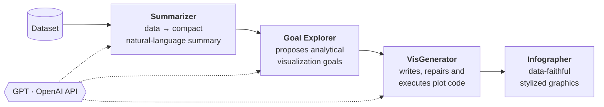
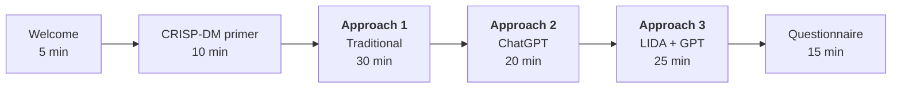

<div align="center">

<sub>RESEARCH PAPER · FRONTIERS IN EDUCATION · 2024</sub>

<h1>LLMs for Data Analytics Learning</h1>

<p>Comparing Traditional Programming, ChatGPT, and LIDA + GPT in Data Analytics Education</p>

<sub>Jorge Valverde-Rebaza · Aram González · Octavio Navarro-Hinojosa · Julieta Noguez</sub><br>
<sub><i>Tecnológico de Monterrey — School of Engineering and Sciences</i></sub>

<a href="https://www.frontiersin.org/journals/education/articles/10.3389/feduc.2024.1418006/full"></a>
<a href="https://doi.org/10.3389/feduc.2024.1418006"></a>


<br>

<table>
  <tr>
    <th colspan="3"><br>Three Learning Approaches<br><br></th>
  </tr>
  <tr>
    <td align="center" width="280"><br><h3>&lt;/&gt;</h3><b>Traditional</b><br><sub>Python + Colab</sub><br><br></td>
    <td align="center" width="280"><br><h3>“…”</h3><b>ChatGPT</b><br><sub>AI coding assistant</sub><br><br></td>
    <td align="center" width="280"><br><h3>▁▃▅▇</h3><b>LIDA + GPT</b><br><sub>AI visual analytics</sub><br><br></td>
  </tr>
  <tr>
    <td colspan="3" align="center">↓<br><br><b>Comparative Learning Experience</b><br><sub>Time · Ease of Use · Speed · Appropriateness · Perceived Correctness</sub><br><br></td>
  </tr>
</table>

<table>
  <tr>
    <td align="center" width="210"><h3>59</h3><sub>Participants</sub></td>
    <td align="center" width="210"><h3>3</h3><sub>Approaches</sub></td>
    <td align="center" width="210"><h3>135</h3><sub>Session minutes</sub></td>
    <td align="center" width="210"><h3>88%</h3><sub>Non-engineering backgrounds</sub></td>
  </tr>
</table>

<sub>
<a href="#-at-a-glance">At a glance</a> ·
<a href="#-the-three-approaches">Approaches</a> ·
<a href="#-study-design">Study design</a> ·
<a href="#-who-took-part">Participants</a> ·
<a href="#-key-findings">Findings</a> ·
<a href="#-implications-for-educators">Implications</a> ·
<a href="#-research-artifacts">Artifacts</a> ·
<a href="#-citation">Citation</a>
</sub>

</div>

<br>

## ◆ At a glance

Generative AI promises to make programming, and therefore data analytics, accessible to people who never learned to code. But **does it actually help them learn?** And does it matter *which* kind of AI assistance they get?

This study puts that question to a controlled test. A cohort of **59 students and professionals without computational backgrounds** built the **same data analytics project three times**: once with traditional Python packages, once with ChatGPT as an external coding assistant, and once with [**LIDA**](https://github.com/microsoft/lida), a visualization-generation framework, connected to **GPT** through the OpenAI API, right inside the notebook.

> [!IMPORTANT]
> **TL;DR.** ChatGPT was perceived as the **easiest and fastest** route. LIDA + GPT was judged the **most appropriate and most correct**, and its projects showed the deepest understanding of data analytics concepts according to the instructors. The catch is an initial API-setup hurdle, which gives it a J-shaped learning curve.

<br>

## ◆ The three approaches

|                     | **① Traditional**                                   | **② ChatGPT**                                           | **③ LIDA + GPT**                                                     |
| :------------------ | :-------------------------------------------------- | :------------------------------------------------------ | :------------------------------------------------------------------- |
| **Role of AI**      | None (baseline)                                     | External programming assistant                          | Specialized data-analytics assistant *inside* the notebook           |
| **Tooling**         | `pandas` · `scikit-learn` · `matplotlib` · `seaborn` | ChatGPT 3.5 / 4 web app, code pasted into Colab         | LIDA library + GPT via OpenAI API, in Colab                          |
| **Learner's job**   | Write and assemble every step by hand               | Craft prompts, then verify and stitch the answers together | Configure the API once, then prompt for summaries, goals and charts |
| **Learning curve**  | Steep                                               | Shallow, but the solution is hard to verify             | J-curve: setup friction, then a smooth flow                          |

<details>
<summary><b>How LIDA + GPT works under the hood</b></summary>
<br>

LIDA treats visualization as a multi-stage pipeline orchestrated by an LLM ([Dibia, 2023](https://github.com/microsoft/lida)). In Approach 3, every stage is called directly from the learner's own notebook:



</details>

<br>

## ◆ Study design

A single **135-minute guided session**, structured around three of the six [CRISP-DM](https://en.wikipedia.org/wiki/Cross-industry_standard_process_for_data_mining) phases: **Business Understanding → Data Understanding → Evaluation**.



Every approach followed the same loop: the instructor demonstrates it on one dataset, then learners apply it **alone, for 10 minutes, with no technical support**, on a second dataset.

|                  | Dataset | Analytical goal                                                                                    |
| :--------------- | :------ | :------------------------------------------------------------------------------------------------- |
| **Instructor demo** | Iris    | *G1: Is there a relationship between sepal length and petal width in different iris species?*     |
| **Learner activity** | Wine    | *G2: Do the chemical components of a wine allow us to identify the class of wine it belongs to?* |

**What was measured** (post-session questionnaire): development time · ease of use · speed of result · appropriateness (focus on analytics rather than programming details) · correctness · plus demographics and prior experience with programming, data analytics and generative AI.

<br>

## ◆ Who took part

**43 undergraduate students** from a Data Analytics course and **16 professionals** from a continuing-education program, all affiliated with Tecnológico de Monterrey (Mexico). **88%** came from finance, business, social sciences and similar fields; the remaining 12% from engineering programs.

<table>
  <tr>
    <td width="33%" align="center"><br><sub><b>Fig. 1</b> · Role × gender</sub></td>
    <td width="33%" align="center"><br><sub><b>Fig. 2</b> · Affiliation</sub></td>
    <td width="33%" align="center"><br><sub><b>Fig. 3</b> · Age range</sub></td>
  </tr>
</table>

Even in 2024, generative AI was far from a given in this cohort:

<div align="center">
<table>
  <tr>
    <td align="center" width="210"><h3>15%</h3><sub>had <b>never</b> used<br>ChatGPT</sub></td>
    <td align="center" width="210"><h3>37%</h3><sub>had never used it for<br>data analytics</sub></td>
    <td align="center" width="210"><h3>29%</h3><sub>had never called<br>an LLM API</sub></td>
    <td align="center" width="210"><h3>40%</h3><sub>of students had never built<br>a data analytics project</sub></td>
  </tr>
</table>
</div>

<details>
<summary><b>Prior experience: programming, data analytics skills and generative AI use</b></summary>
<br>

Programming experience was fairly even across roles, genders and age groups. The one exception was professionals over 50, the only group that included participants (all women) with no prior programming experience. Data analytics skills showed the clearest gender gap, especially among younger learners.

<p align="center">
  <br>
  <sub><b>Fig. 5</b> · Programming experience by role, age range and gender</sub>
</p>

<p align="center">
  <br>
  <sub><b>Fig. 7</b> · Data analytics–related skills by role, age range and gender</sub>
</p>

<p align="center">
  <br>
  <sub><b>Fig. 9</b> · Prior use of ChatGPT (general use · programming · data analytics) and of LLM APIs</sub>
</p>

</details>

<br>

## ◆ Key findings

### 1 · Generative AI shortens the path to a result

Only with **ChatGPT** or **LIDA + GPT** did some participants finish the project in **under 5 minutes**. With the traditional approach, most needed **more than 10 minutes**. About **40% of professionals** finished within 10 minutes using either AI approach; among students, 35% did so with ChatGPT and 15% with LIDA + GPT.

<p align="center">
  <br>
  <sub><b>Fig. 10</b> · Time required to finish the activity, by role and approach</sub>
</p>

### 2 · ChatGPT feels easiest, LIDA + GPT feels most right

| Perception           | ① Traditional | ② ChatGPT | ③ LIDA + GPT |
| :------------------- | :-----------: | :-------: | :----------: |
| Ease of use          |               |  **1st**  |     2nd      |
| Speed of result      |               |  **1st**  |     2nd      |
| Appropriateness      |               |    2nd    |   **1st**    |
| Correctness          |               |    2nd    |   **1st**    |

<sub><b>1st</b> most frequently chosen · 2nd runner-up. The pattern is consistent across roles (students vs. professionals) and genders.</sub>

**Every professional** named ChatGPT the easiest way to tackle the project. When the question shifted from *"what was easy?"* to *"what kept you focused on the analysis, and what produced coherent, explanatory results?"*, the preference moved to **LIDA + GPT**.

<table>
  <tr>
    <td width="50%" align="center"><br><sub><b>Fig. 11</b> · Perceptions by role</sub></td>
    <td width="50%" align="center"><br><sub><b>Fig. 12</b> · Perceptions by gender</sub></td>
  </tr>
</table>

### 3 · Better projects with LIDA + GPT

In the instructors' evaluation of the submitted projects, those built with **LIDA + GPT showed stronger comprehension and application of data analytics concepts**, regardless of the learner's background. They were also richer in narrative and gave clearer, more compelling presentations of insights.

### 4 · Three different learning curves

<table>
  <tr>
    <td width="33%" valign="top"><b>Traditional: steep</b><br><sub>Learners must master programming, statistics and libraries at once, and struggle both to build the solution and to interpret its results.</sub></td>
    <td width="33%" valign="top"><b>ChatGPT: shallow</b><br><sub>Easy to start, but learners must judge whether the generated "solution" is right and merge scattered answers into one coherent project.</sub></td>
    <td width="33%" valign="top"><b>LIDA + GPT: J-curve</b><br><sub>Initial friction configuring the API: 20% of students and 10% of professionals needed over 30 min. After that, the workflow is smooth and goal-oriented.</sub></td>
  </tr>
</table>

<br>

## ◆ Implications for educators

> [!TIP]
> **Teach the process, not just the prompt.** With general-purpose assistants such as ChatGPT, learners must understand the analytics pipeline well enough to catch errors and missing requirements on their own. A methodology like CRISP-DM gives them that compass.

- **Specialized tools close the gap.** Frameworks like LIDA reduce those deficiencies by grounding the LLM in the data and the analytical goal.
- **Remove the setup barrier.** API configuration is the main obstacle in LIDA + GPT. Pre-configured environments let learners skip straight to the steep, rewarding part of the J-curve.
- **Don't dismiss traditional coding.** Some learners, notably female students, perceived the traditional approach as the *most correct*. Trust and control matter, and AI tools still need to earn learners' confidence.

> [!NOTE]
> **Limitations.** A heterogeneous cohort (affiliations and ages), short activity windows (10 min per approach) and a single session. Further validation is needed for critical-thinking acquisition and for learners' insecurity about AI-generated solutions. Future work will use larger cohorts, compare LIDA with similar tools, and evaluate LLMs beyond GPT.

<br>

## ◆ Research artifacts

Everything needed to inspect and reproduce the paper's analysis is openly available:

| Artifact | Description |
| :------- | :---------- |
| [**Full paper (PDF)**](feduc-09-1418006.pdf) | Open-access article as published in *Frontiers in Education* |
| [**Paper online**](https://www.frontiersin.org/journals/education/articles/10.3389/feduc.2024.1418006/full) | HTML version with interactive figures and references |
| [**Case-study dataset**](https://www.frontiersin.org/journals/education/articles/10.3389/feduc.2024.1418006/full#supplementary-material) | Questionnaire responses behind every result (*Supplementary Material*, Data Sheet 1) |
| [**`Data_processing.ipynb`**](Data_processing.ipynb) | Analysis notebook that generates every figure in the article from the dataset |
| [**`images/`**](images) | Publication-quality vector figures (EPS) |
| [**IACEE 2024 slides**](materials/session7-JorgeValverde-IACEE-24.pdf) | Conference presentation of the preliminary study |
| [**IACEE 2024 extended abstract**](https://www.researchgate.net/publication/382695760_Empowering_Data_Analytics_Learning_Leveraging_Advanced_Large_Language_Models_and_Visualization_Tools) | *Empowering Data Analytics Learning*, 19th World Conference on Continuing Engineering Education |

<br>

## ◆ Citation

<div align="center">

<a href="https://www.frontiersin.org/journals/education/articles/10.3389/feduc.2024.1418006/full"></a>
<a href="feduc-09-1418006.pdf"></a>
<a href="https://doi.org/10.3389/feduc.2024.1418006"></a>

</div>

If this work is useful for your research or teaching, please cite:

> Valverde-Rebaza, J., González, A., Navarro-Hinojosa, O., & Noguez, J. (2024). Advanced large language models and visualization tools for data analytics learning. *Frontiers in Education, 9*, 1418006. https://doi.org/10.3389/feduc.2024.1418006

```bibtex
@article{valverde:frontiers:24,
  title     = {Advanced large language models and visualization tools for data analytics learning},
  author    = {Valverde-Rebaza, Jorge and Gonz{\'a}lez, Aram and Navarro-Hinojosa, Octavio and Noguez, Julieta},
  journal   = {Frontiers in Education},
  volume    = {9},
  pages     = {1418006},
  year      = {2024},
  publisher = {Frontiers Media SA},
  issn      = {2504-284X},
  doi       = {10.3389/feduc.2024.1418006},
  url       = {https://www.frontiersin.org/journals/education/articles/10.3389/feduc.2024.1418006}
}
```

<details>
<summary><b>Conference extended abstract (IACEE 2024)</b></summary>
<br>

> Valverde-Rebaza, J., González, A., Navarro-Hinojosa, O., & Noguez, J. (2024). Empowering Data Analytics Learning: Leveraging Advanced Large Language Models and Visualization Tools. In *Proceedings of the 19th World Conference on Continuing Engineering Education (IACEE 2024)*, pp. 47–49. ISBN 978-1-7327114-3-3.

```bibtex
@inproceedings{Valverde:iacee:24b,
  title     = {{Empowering Data Analytics Learning: Leveraging Advanced Large Language Models and Visualization Tools}},
  author    = {Valverde-Rebaza, Jorge and Gonz{\'a}lez, Aram and Navarro-Hinojosa, Octavio and Noguez, Julieta},
  booktitle = {Proceedings of the 19th World Conference on Continuing Engineering Education},
  series    = {IACEE 2024},
  pages     = {47--49},
  publisher = {IACEE},
  isbn      = {978-1-7327114-3-3},
  year      = {2024}
}
```

</details>

<br>

---

<div align="center">
<sub>
Code released under the <a href="LICENSE">MIT License</a> · Article and figures copyright 2024 the authors, distributed under <a href="https://creativecommons.org/licenses/by/4.0/">CC BY 4.0</a><br>
Partially supported by the NOVUS grant 2023-419283 (PEP No. PHHT085-23ZZNV041), Tecnológico de Monterrey
</sub>
</div>
